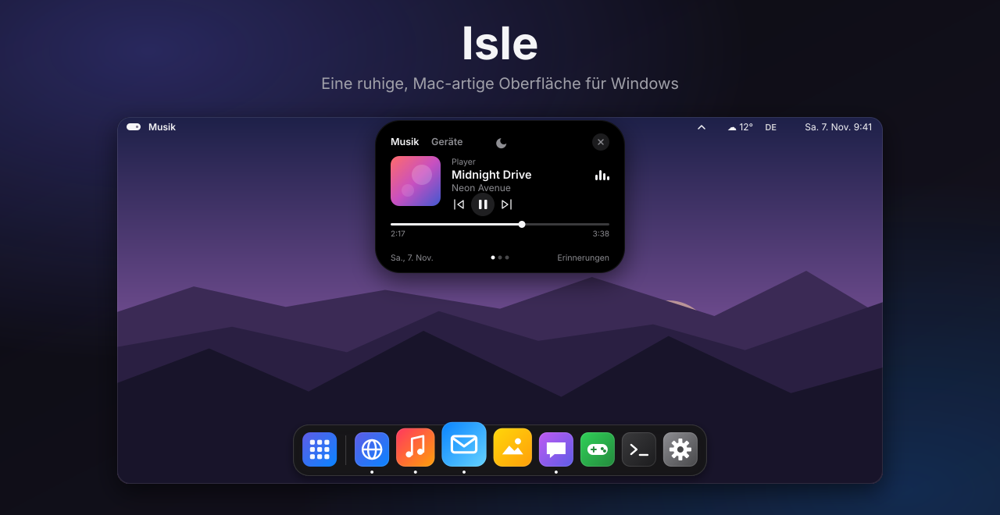
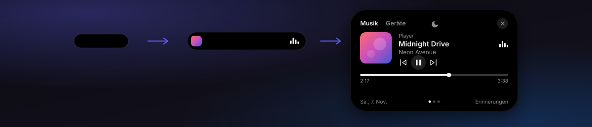
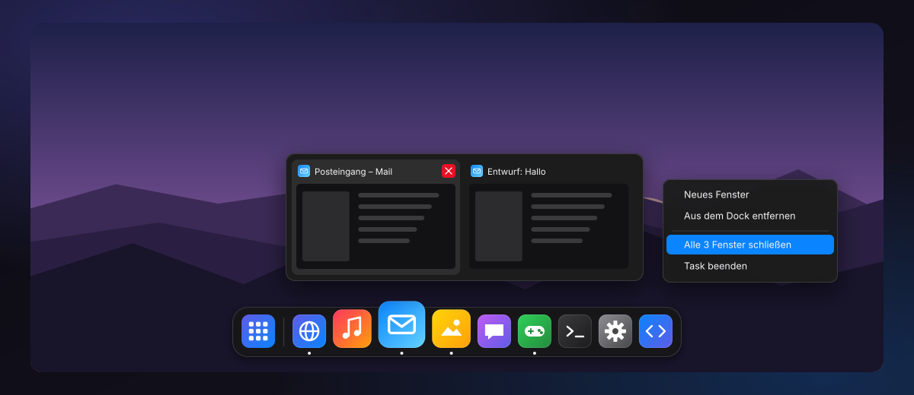
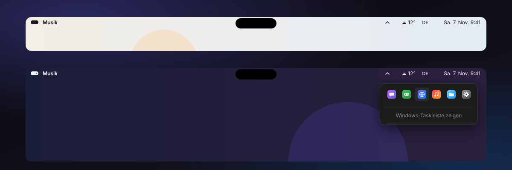
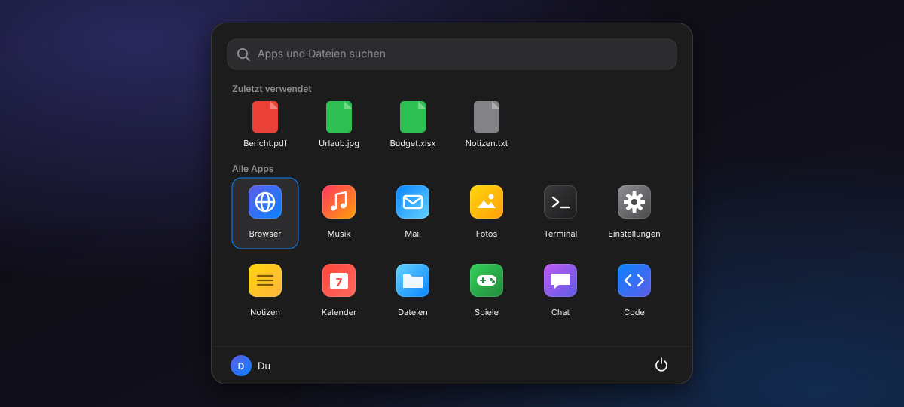

  

  
  
  
  

  <a href="README.md">English</a> &nbsp;·&nbsp; <b>Deutsch</b>

  <a href="https://github.com/noah1o7/Isle-Desktop/releases/latest"><b>⬇&nbsp;&nbsp;Für Windows herunterladen</b></a> &nbsp;&nbsp;|&nbsp;&nbsp; <a href="https://noah1o7.github.io/Isle-Desktop/?lang=de"><b>Webseite</b></a>

---

**Isle** macht Windows ein bisschen ruhiger und vertrauter: eine durchsichtige **Top-Bar**, eine **Dynamic Island** für deine Musik, ein **Dock** mit Live-Fenstervorschau und ein schnelles **Startmenü** – alles im einheitlichen Dark Mode. Isle liegt über deinem normalen Windows; deine Programme laufen ganz normal weiter, und beim Beenden ist alles wieder wie vorher.

| | |
|---|---|
| 🏝️ **Dynamic Island** – Musik, Geräte, Erinnerungen | 🧭 **Top-Bar** – Schriftfarbe passt sich dem Hintergrund an |
| 🚀 **Dock** – Vergrößerung, Verschieben, Live-Vorschau | 🔎 **Startmenü** – Windows-Taste drücken, lostippen |

## Download

1. **`Isle-Desktop-…-win-x64.zip`** aus der [neuesten Version](https://github.com/noah1o7/Isle-Desktop/releases/latest) herunterladen
2. Entpacken (Rechtsklick → *Alle extrahieren*) und **`Isle.exe`** starten
3. Windows zeigt evtl. *„Der Computer wurde durch Windows geschützt“*, weil Isle nicht mit einem kostenpflichtigen Zertifikat signiert ist → *Weitere Informationen* → *Trotzdem ausführen*

Keine Installation, nichts zusätzlich nötig. Läuft auf **Windows 10 (ab Version 2004) und Windows 11**, 64 Bit.
**Beenden:** <kbd>Strg</kbd> + <kbd>Alt</kbd> + <kbd>Q</kbd> oder Isle-Menü (Pillen-Symbol oben links) → *Isle beenden* – die Windows-Taskleiste kommt dann zurück.

## Dynamic Island

- Ruht als kleine Pille, zeigt **Cover und hüpfende Balken**, sobald Musik läuft, und **klappt auf, wenn du mit der Maus drübergehst**
- **Musik:** Cover (Klick holt den Player nach vorn), Titel, Interpret, Zurück / Pause / Weiter, Fortschrittsbalken zum Spulen
- **Geräte:** Ausgabegerät wechseln (Lautsprecher, Kopfhörer …), Lautstärke und Stumm – oder einfach mit dem Mausrad über der Insel
- **Erinnerungen:** `18:30 Wäsche` eintippen und Enter – um 18:30 meldet sich die Insel
- **Fokus (Mond):** keine Song-Hinweise mehr, Erinnerungen kommen trotzdem
- Funktioniert mit Spotify, Browsern (YouTube …), Windows Media Player, VLC und allem, was die Windows-Mediensteuerung nutzt
- Klickbar ist nur die Insel selbst – direkt darunter kannst du ganz normal klicken

## Dock

- Angeheftete und laufende Apps mit Punkt, **Vergrößerung** beim Drüberfahren, kleiner **Hüpfer** beim Starten
- **Live-Fenstervorschau:** Maus auf eine laufende App → ein Kärtchen pro Fenster. Klick wechselt, ✕ oder Mittelklick schließt
- **Icons verschieben** – die anderen gleiten zur Seite. Icon **nach oben herausziehen** entfernt es
- Programm, Verknüpfung, Datei oder Ordner **aufs Dock ziehen** heftet es an
- **Rechtsklick:** Fensterliste, Neues Fenster, Behalten / Entfernen, *Alle Fenster schließen*, *Task beenden*
- Übernimmt automatisch die Apps, die an deine **Windows-Taskleiste** angeheftet sind (auch Store-Apps)

## Top-Bar

- **Durchsichtig** – Isle misst, was hinter der Leiste ist (links und rechts getrennt), und wechselt zwischen **dunkler und weißer Schrift**, damit sie immer lesbar bleibt
- Isle-Menü, aktive App, Wetter, Akku, Tastatursprache, Datum und Uhr, Kamera- und Mikrofon-Anzeige
- **Tray-Icons** (Discord, Steam, VPN …) öffnen sich direkt unter dem ⌃-Pfeil – Links-, Doppel- und Rechtsklick wie in der Taskleiste
- Schriftstärke unter *Einstellungen* von *Dünn* bis *Fett* einstellbar

## Startmenü

- Öffnet sich mit der **Windows-Taste** – einfach lostippen, Pfeiltasten + Enter startet, Esc schließt
- Zuletzt verwendete Dateien, alle Apps (auch Store-Apps), Websuche
- Rechtsklick auf eine App: Im Dock behalten, Als Administrator ausführen, Speicherort öffnen
- Sperren, Energie sparen, Neu starten, Herunterfahren, Abmelden
- Tastenkürzel wie <kbd>Win</kbd>+<kbd>D</kbd>, <kbd>Win</kbd>+<kbd>E</kbd> und <kbd>Win</kbd>+<kbd>L</kbd> funktionieren wie gewohnt

## Die Windows-Taskleiste

Solange Isle läuft, ist die Windows-Taskleiste **komplett ausgeblendet**. Maximierte Fenster enden unter der Top-Bar und über dem Dock. Beim Beenden – und sogar wenn Isle abstürzt – holt ein kleiner Wächter die Taskleiste automatisch zurück (darum steht `Isle.exe` zweimal im Task-Manager).

## Einstellungen

Alles im **Isle-Menü** (Pillen-Symbol oben links) und unter *Einstellungen …*: Dock an/aus, Taskleiste ausblenden, Tray-Icons in der Top-Bar, Windows-Taste, mit Windows starten, Wetter-Ort, Schriftfarbe und -stärke der Leiste.
Gespeichert wird in `%AppData%\Isle\settings.json`, ein kleines Protokoll liegt daneben in `isle.log`.

## Häufige Fragen

<b>Wie bekomme ich meine normale Taskleiste zurück?</b>

Isle mit <kbd>Strg</kbd> + <kbd>Alt</kbd> + <kbd>Q</kbd> beenden – oder im Isle-Menü den Haken bei *Windows-Taskleiste ausblenden* entfernen. Isle verändert keine Systemdateien, es blendet die Taskleiste nur aus, solange es läuft.

<b>Warum warnt Windows beim Starten?</b>

Signatur-Zertifikate kosten Geld, deshalb ist Isle nicht signiert. Das löst die SmartScreen-Warnung bei jedem neuen, unsignierten Programm aus. Der komplette Quellcode liegt hier im Repository.

<b>Sendet Isle Daten?</b>

Nein. Die einzige Verbindung ins Internet ist das Wetter von <a href="https://open-meteo.com">Open-Meteo</a> (kostenlos, ohne Konto) – und erst, wenn du einen Ort festgelegt hast.

<b>Die Schrift in der Top-Bar hat die falsche Farbe.</b>

Im Isle-Menü eine feste Farbe wählen (<i>Leiste: Schrift immer dunkel / hell</i>). Die Messwerte stehen in <code>%AppData%\Isle\isle.log</code>.

## Selbst bauen

1. Einmalig das .NET 8 SDK installieren: `winget install Microsoft.DotNet.SDK.8`
2. Repository herunterladen und **`build.bat`** doppelklicken – baut und startet `dist\Isle.exe`

Aufbau des Projekts

| Datei | Inhalt |
|---|---|
| `App.xaml(.cs)` | Start, dunkles Design, verbindet alle Teile |
| `TopBar.xaml(.cs)` | Top-Bar |
| `MainWindow.xaml(.cs)` | Dynamic Island |
| `Dock.xaml(.cs)` | Dock (Verschieben, Vergrößern, Menüs, Drag & Drop) |
| `StartMenu.xaml(.cs)` | Startmenü |
| `WindowPreview.cs` | Live-Fenstervorschau (DWM) |
| `TrayHost.cs` | Empfängt die Tray-Icons aller Programme (und reicht sie an Windows weiter) |
| `MediaService.cs` | Windows-Mediensteuerung |
| `AudioDevices.cs` | Ausgabegeräte und Lautstärke |
| `ScreenTone.cs`, `WallpaperTone.cs` | Helligkeit hinter der Top-Bar |
| `AppBar.cs` | Bildschirmränder reservieren, Taskleiste ausblenden |
| `WinEvents.cs` | Fensteränderungen per Ereignis (statt Dauerabfrage) |
| `AppCatalog.cs`, `ShellIcons.cs`, `WindowTracker.cs`, `TaskbarPins.cs` | Apps, Icons, laufende Fenster, Taskleisten-Pins |
| `KeyboardHook.cs`, `Menus.cs`, `Win32.cs`, `NativeMethods.cs` | Windows-Taste, Menüs, Windows-API |

---

Isle ist ein unabhängiges Hobby-Projekt und gehört weder zu Apple noch zu Microsoft. Die Bilder auf dieser Seite sind gezeichnete Illustrationen der Oberfläche, keine Screenshots; die App-Icons darin sind Platzhalter.
