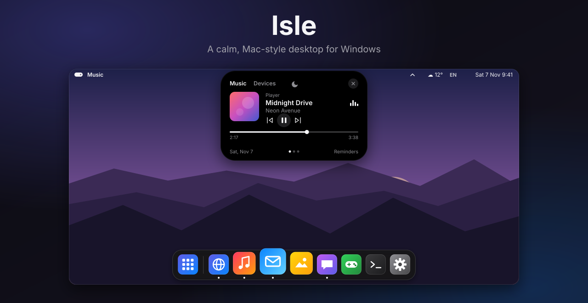
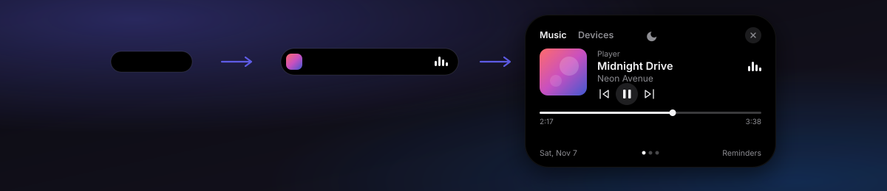
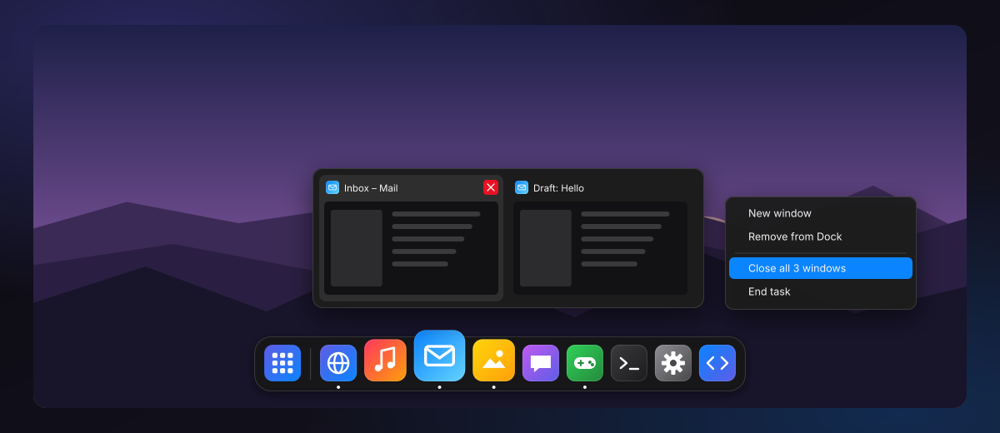
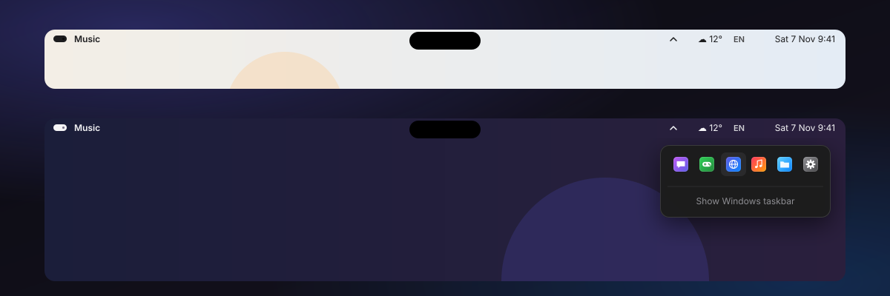
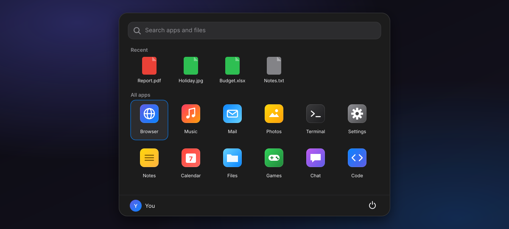

  

  
  
  
  

  <b>English</b> &nbsp;·&nbsp; <a href="README.de.md">Deutsch</a>

  <a href="https://github.com/noah1o7/Isle-Desktop/releases/latest"><b>⬇&nbsp;&nbsp;Download for Windows</b></a> &nbsp;&nbsp;|&nbsp;&nbsp; <a href="https://noah1o7.github.io/Isle-Desktop/"><b>Website</b></a>

---

**Isle** gives Windows a calmer, Mac-inspired home: a transparent **top bar**, a **Dynamic Island** for your music, a **dock** with live window previews and a fast **start menu** — all in a consistent dark design. It sits on top of your normal Windows; your apps keep working exactly as before, and quitting Isle puts everything back.

| | |
|---|---|
| 🏝️ **Dynamic Island** — now playing, devices, reminders | 🧭 **Top bar** — adapts its text color to your wallpaper |
| 🚀 **Dock** — magnification, drag to reorder, live previews | 🔎 **Start menu** — opens with the Windows key, type to search |

## Download

1. Download **`Isle-Desktop-…-win-x64.zip`** from the [latest release](https://github.com/noah1o7/Isle-Desktop/releases/latest)
2. Extract it (right-click → *Extract All*) and run **`Isle.exe`**
3. Windows may show *“Windows protected your PC”* because Isle isn't signed with a paid certificate → *More info* → *Run anyway*

No installation or extra runtime needed. Works on **Windows 10 (version 2004 or newer) and Windows 11**, 64-bit.
> **Note:** Isle's interface is currently in **German**. Menu items are quoted below with their German labels.
**Quit:** <kbd>Ctrl</kbd> + <kbd>Alt</kbd> + <kbd>Q</kbd> or Isle menu (pill icon, top left) → *Isle beenden* — your Windows taskbar comes back.

## Dynamic Island

- Rests as a small pill, shows **cover art and live bars** while music plays, and **expands on hover**
- **Music:** cover (click to bring the player to front), title, artist, previous / play-pause / next, drag the progress bar to seek
- **Devices:** switch the audio output (speakers, headphones …), volume and mute — or just scroll over the island
- **Reminders:** type `18:30 laundry` and press Enter — the island taps you on the shoulder at 18:30
- **Focus (moon):** no more “now playing” pop-ups; reminders still come through
- Works with Spotify, browsers (YouTube …), Windows Media Player, VLC and anything else that uses Windows media controls
- Only the island itself is clickable — you can always click things right below it

## Dock

- Pinned and running apps with a dot, **magnification** on hover, a little **bounce** on launch
- **Live window previews:** hover a running app → one card per window. Click to switch, ✕ or middle-click to close
- **Drag to reorder** — neighbours glide out of the way. Drag an icon **up and out** to remove it
- **Drop** any program, shortcut, file or folder onto the dock to pin it
- **Right-click:** window list, new window, keep / remove, *Close all windows*, *End task*
- Imports the apps **pinned to your Windows taskbar** (including Store apps) automatically

## Top bar

- **Transparent** — Isle measures what's behind the bar (left and right separately) and switches between **dark and white text** so it always stays readable
- Isle menu, active app, weather, battery, keyboard language, date and time, camera / microphone indicators
- **Tray icons** (Discord, Steam, VPN …) open right below the ⌃ arrow — left, double and right click work like on the taskbar
- Font weight adjustable from *Dünn* (thin) to *Fett* (bold) in *Einstellungen* (settings)

## Start menu

- Opens with the **Windows key** — just start typing, arrow keys + Enter to launch, Esc to close
- In games (fullscreen) the Windows key brings the dock and top bar to the front too
- Recent files, all apps (including Store apps), web search
- Right-click an app: keep in dock, run as administrator, open file location
- Lock, sleep, restart, shut down, sign out
- Shortcuts like <kbd>Win</kbd>+<kbd>D</kbd>, <kbd>Win</kbd>+<kbd>E</kbd> and <kbd>Win</kbd>+<kbd>L</kbd> keep working as usual

## The Windows taskbar

While Isle runs, the Windows taskbar is **hidden completely**. Maximized windows end below the top bar and above the dock. When you quit Isle — and even if it crashes — a small watchdog restores the taskbar automatically (that's why you see `Isle.exe` twice in Task Manager).

## Settings

Everything lives in the **Isle menu** (pill icon, top left) and under *Einstellungen …*: dock on/off, hide taskbar, tray icons in the top bar, Windows key, show the island in games, start with Windows, weather location, text color and weight of the top bar.
Settings are stored in `%AppData%\Isle\settings.json`, a small log in `isle.log` next to it.

## FAQ

<b>How do I get my normal taskbar back?</b>

Quit Isle with <kbd>Ctrl</kbd> + <kbd>Alt</kbd> + <kbd>Q</kbd> — or untick *Windows-Taskleiste ausblenden* in the Isle menu. Isle never changes system files; it only hides the taskbar while it runs.

<b>Why does Windows warn me when I start it?</b>

Code-signing certificates cost money, so Isle is unsigned. That triggers SmartScreen for every new, unsigned program. The full source code is in this repository.

<b>Does Isle send any data?</b>

No. The only network request is the weather from <a href="https://open-meteo.com">Open-Meteo</a> (free, no account), and only after you set a location.

<b>The top bar text has the wrong color.</b>

Pick a fixed color in the Isle menu (<i>Leiste: Schrift immer dunkel / hell</i>). The measured values are written to <code>%AppData%\Isle\isle.log</code>.

## Build from source

1. Install the .NET 8 SDK once: `winget install Microsoft.DotNet.SDK.8`
2. Clone or download this repository and double-click **`build.bat`** — it builds and starts `dist\Isle.exe`

Project structure

| File | Purpose |
|---|---|
| `App.xaml(.cs)` | Startup, dark styles, wires everything together |
| `TopBar.xaml(.cs)` | Top bar |
| `MainWindow.xaml(.cs)` | Dynamic Island |
| `Dock.xaml(.cs)` | Dock (reorder, magnification, menus, drag & drop) |
| `StartMenu.xaml(.cs)` | Start menu |
| `WindowPreview.cs` | Live window previews (DWM thumbnails) |
| `TrayHost.cs` | Receives the tray icons of all apps (and forwards them to Windows) |
| `MediaService.cs` | Windows media controls |
| `AudioDevices.cs` | Output devices and volume |
| `ScreenTone.cs`, `WallpaperTone.cs` | Brightness behind the top bar |
| `AppBar.cs` | Reserves screen edges, hides the taskbar |
| `WinEvents.cs` | Event-driven window tracking (no constant polling) |
| `AppCatalog.cs`, `ShellIcons.cs`, `WindowTracker.cs`, `TaskbarPins.cs` | Apps, icons, running windows, taskbar pins |
| `KeyboardHook.cs`, `Menus.cs`, `Win32.cs`, `NativeMethods.cs` | Windows key, menus, Windows API |

---

Isle is an independent hobby project and is not affiliated with Apple or Microsoft. The images on this page are drawn illustrations of Isle's interface, not screenshots; app icons in them are generic placeholders.
